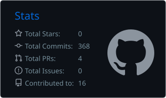
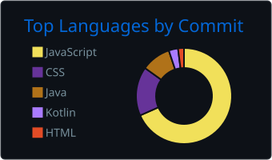
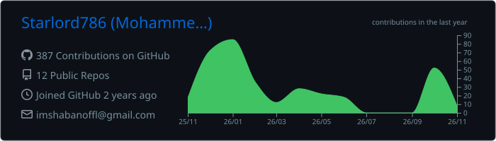
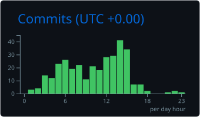

<!-- ================================================== -->
<!-- MOHAMMED SHABAN | SOFTWARE DEVELOPER PROFILE -->
<!-- ================================================== -->

<h1 align="center">Mohammed Shaban</h1>

<h3 align="center">
  SOFTWARE DEVELOPER / FULL-STACK ENGINEER
</h3>

<p align="center">
  <code>Engineering solutions through code.</code>
</p>

<p align="center">
  
</p>

---

## `01 / INTRODUCTION`

```bash
┌──(shaban㉿github)-[~]
└─$ whoami

Mohammed Shaban
Software Developer | CSE Student
Tamil Nadu, India

└─$ cat about.txt

Passionate developer focused on building practical
software applications and exploring modern technologies.

Interested in backend engineering, full-stack development,
artificial intelligence and scalable applications.

└─$ 
```

---

## `02 / TECHNICAL EXPERTISE`

**Backend Engineering**

<p>
  
</p>

**Frontend Development**

<p>
  
</p>

**Database Technologies**

<p>
  
</p>

**Developer Tools**

<p>
  
</p>

---

## `03 / FEATURED PROJECT`

### AI-Powered Workforce Management System

`JAVA` `SPRING BOOT` `REACT` `PYTHON` `POSTGRESQL`

An intelligent workforce management platform designed to simplify HR operations through automation and artificial intelligence.

**Key Features**

- Employee management and role-based access.
- Face recognition attendance system.
- AI-powered employee shift scheduling.
- Employee attrition prediction.
- AI-powered HR chatbot using Ollama.
- Payroll, leave and task management.
- JWT authentication and authorization.

<p>
  <a href="https://github.com/Starlord786/workforce-system">
    
  </a>
</p>

---

## `04 / CURRENT FOCUS`

```text
[+] REST API Development
[+] Spring Boot & Backend Engineering
[+] Full-Stack Application Development
[+] Artificial Intelligence Integration
[+] Software Engineering Practices
```

---
## `05 / GITHUB ANALYTICS`

<p align="center">
  
  
</p>

<p align="center">
  
</p>

---

## `06 / CONTRIBUTION HISTORY`

<p align="center">
  
  
</p>

## `07 / CONNECT`

```bash
┌──(shaban㉿github)-[~/connect]
└─$ ./establish_connection --open

[✓] Status      : Available for collaboration
[✓] Interests   : Backend · Full-Stack · AI Integration
[✓] Response    : Usually within 24 hours

└─$ ls ./channels

  linkedin/    email/    leetcode/    hybixgroups/

└─$ _
```

<p align="center">
  <a href="https://www.linkedin.com/in/mohammed-shaban-434188291">
    
  </a>
  <a href="mailto:imshabanoffl@gmail.com">
    
  </a>
</p>

<p align="center">
  <a href="https://leetcode.com/u/Mohammed_Shaban/">
    
  </a>
  <a href="https://hybixgroups.com">
    
  </a>
</p>

<p align="center">
  <sub><code>Have an idea? Let's build something meaningful.</code></sub>
</p>

<p align="center">
  <code>OPEN TO COLLABORATION · BUILDING · INNOVATION</code>
</p>
